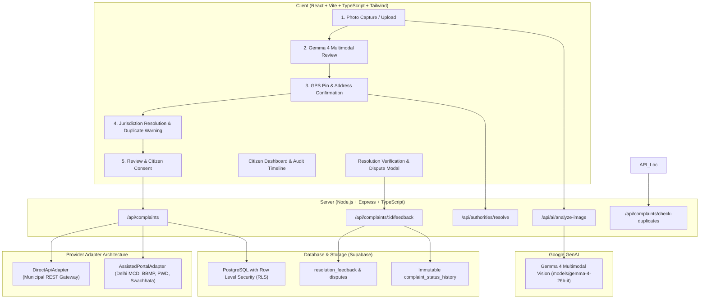

# CivicSnap — Production-Grade AI Civic Complaint & Accountability Platform

CivicSnap enables citizens to report potholes, garbage dumps, broken streetlights, water leaks, and civic infrastructure hazards with minimal friction. 

> **Core Promise**: Upload a photo. Let Gemma 4 understand the problem. Confirm the location. Review and edit the complaint draft. Submit through verified official channels. Track genuine updates with citizen accountability verification.

---

## 1. System Architecture



---

## 2. Key Product Highlights

### A. Real Gemma 4 Multimodal Vision
- Integrates Google's official `@google/genai` SDK with vision capabilities.
- Evaluates photo evidence quality (blurriness, night-time lighting, visibility).
- Generates structured, typed civic assessments adhering to strict Zod schemas:
  - Issue category (`POTHOLE`, `GARBAGE_DUMP`, `BROKEN_STREETLIGHT`, `WATER_LEAKAGE`, etc.)
  - Severity level (`LOW`, `MEDIUM`, `HIGH`, `CRITICAL`) with civic impact justification
  - Observable evidence vs. optical uncertainties
  - Missing information checklist
  - Dual-language formal grievance draft (English & Hindi)
- AI output is treated strictly as a **suggestion**—the citizen retains full edit control and must approve before dispatch.

### B. Transparent Authority Resolution & Provider Adapters
- Automatically resolves responsible authorities based on GPS coordinates and issue category:
  - **MCD Delhi (DEMS)** for sanitation & garbage in Delhi NCR
  - **Delhi PWD** for arterial roads, potholes, and sidewalks
  - **Delhi Jal Board (DJB)** for water leakage & burst pipelines
  - **BBMP Bengaluru** for urban local body grievances in Bengaluru
  - **MoHUA Swachhata** for pan-India municipal waste escalation
  - **Open Municipal Sandbox** for direct REST API end-to-end receipt generation
- **No fabricated credentials or receipts**: In `ASSISTED_PORTAL` mode, CivicSnap formats a complete civic dossier and routes the citizen to the verified portal, preserving the draft as awaiting citizen submission.

### C. Citizen Accountability & Dispute Lifecycle
- Prevents civic authorities from unilaterally marking tickets as resolved.
- Complainant verifies on-ground resolution: **Fully Resolved**, **Partially Resolved**, or **Still Unresolved (Dispute)**.
- Includes 1–5 star department satisfaction ratings and dispute justifications.
- Enforces an immutable audit timeline in `complaint_status_history`.

### D. Duplicate Issue Detection
- Computes Haversine distance against recent active complaints within 60 meters.
- Prevents redundant municipal work while allowing citizens to add photographic corroboration.

---

## 3. Quick Start & Setup

### Prerequisites
- Node.js >= 20.x
- npm >= 10.x

### Installation
```bash
# Clone repository
git clone https://github.com/null_parthx/civicSnapHacktoberFest.git
cd civicSnapHacktoberFest

# Install dependencies across all workspaces
npm install
```

### Environment Configuration
Copy `.env.example` to `.env`:
```bash
cp .env.example .env
```
Fill in the following variables:
```ini
PORT=4000
NODE_ENV=development
CLIENT_ORIGIN=http://localhost:5173

# Google AI Studio key for Gemma 4 vision
GEMINI_API_KEY=your_key_here
GEMMA_MODEL_ID=models/gemma-4-26b-it

# Supabase Credentials (optional for local in-memory test run)
SUPABASE_URL=https://your-project.supabase.co
SUPABASE_ANON_KEY=your_anon_key
SUPABASE_SERVICE_ROLE_KEY=your_service_role_key
```

### Running Locally
```bash
# Start backend server
npm run dev:server

# In a separate terminal, start frontend
npm run dev:client
```
Open [http://localhost:5173](http://localhost:5173) in your browser.

---

## 4. Supabase Database & Security

Execute the migration file located at:
`supabase/migrations/20261026000000_civic_snap_schema.sql`

And seed verified authorities with:
`supabase/seed.sql`

### Security Guarantees:
- **Row Level Security (RLS)** enabled on all tables:
  - Users can read, create, and update only their own complaints.
  - Evidence and submission attempts are constrained by `EXISTS (SELECT 1 FROM complaints WHERE user_id = auth.uid())`.
- Server-side validation using Zod on every payload.
- Helmet security headers and CORS protection.
- Rate limiting on `/api/*` endpoints.

---

## 5. Verification & Testing

CivicSnap includes test coverage for authority resolution, duplicate checking, RLS isolation, dispute lifecycle, and AI validation.

```bash
# Run unit & integration tests
npm test

# Build production bundles
npm run build
```
